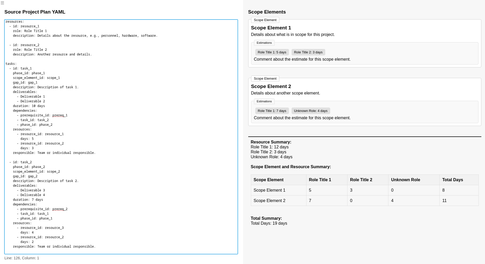
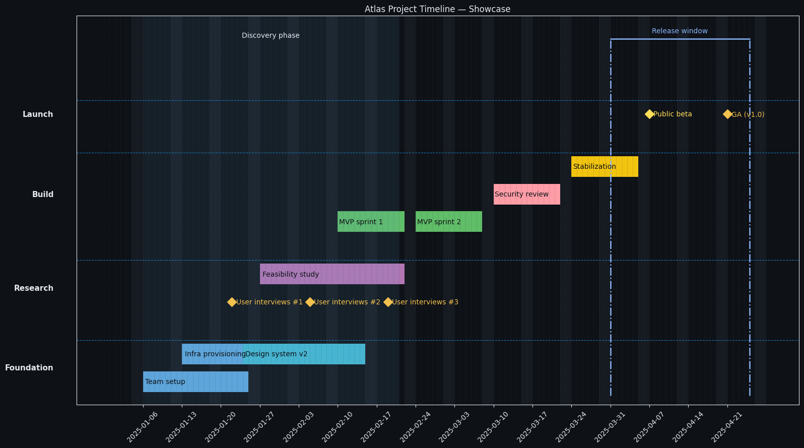

# Local Project Tools

This repository contains tools and resources for managing and visualizing project plans. The tools are designed to help you understand the scope, phases, and architectural gaps of your projects.

It's all meant to be in-browser (except timeline generation):

* Either clone this repository and open the index.html file in the browser...
* or access via github pages

# Examples:

## Scope Elements

## Timeline Generation (Python)

